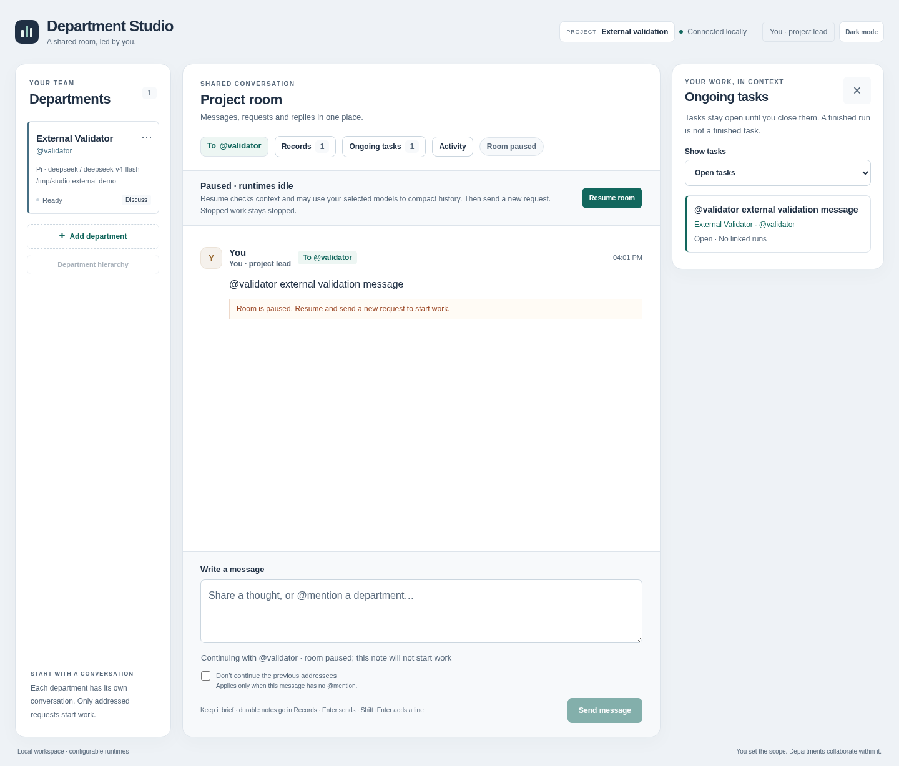

# Using Department Studio from another project

Status: **current usage guide for the implemented Web room.** It is written for a
human or another agent session that wants to use this checkout from a separate
project directory. It does not claim that workers, task-issue dispatch, Feishu,
WeChat or A2A are implemented.

## What works now

- A local Web room with an owner credential.
- Multiple isolated project rooms, with history/create/switch/delete.
- User-named departments with a lead runtime/model/workspace.
- Optional per-department **worker model** (configuration only; worker execution is
  not implemented).
- Leads are **Discuss-only**: read/search/list, room messages and bounded records.
  There is no lead Discuss/Develop switch.
- Records, department hierarchy, default addressing, peer-message folding and
  light/dark theme.
- Human-created/mapped ongoing tasks metadata; task execution and worker dispatch are
  not implemented.
- A project's workspace and its Studio data are separate: the workspace is where
  future work will happen; the data directory owns the room database, records,
  sessions and project metadata.

## What is not implemented

Do not infer these from the UI or design documents:

- summoning workers or running a worker session;
- lead-created task proposals, issue creation, worker reports/acceptance or a
  watchdog;
- GitHub issue/PR execution as the work protocol;
- direct superagent chat, A2A, Feishu or WeChat channel adapters;
- automatic live model verification. A bounded 2026-11-21 attempt was blocked by a
  read-only Pi config directory, an invalid DeepSeek key (HTTP 401), and a Claude
  Code smoke run that did not finish.

See [documentation and plan status](documentation-status.md) and the
[hybrid design](superagent-reuse-hybrid.md) for the planned next increments.

## 1. Requirements

- Linux/POSIX is the verified target.
- `uv` is required for Python environment and commands. Do not use bare `python`,
  `pip`, Poetry, Conda or a manually created venv.
- Python 3.12 is declared by the project.
- At least one runtime if you want model-backed replies: Pi, Claude Code or DeepSeek
  Harness. A missing runtime does not prevent the room or project management from
  loading; it prevents that runtime's deliveries.
- A model catalog key in the launching environment for inference. The browser never
  receives the key.

## 2. Start from this checkout, with data outside it

The current repository is only the application. Do not use it as the validation
project workspace and do not store the new project's room data inside it.

```bash
cd /path/to/department-studio
uv sync --locked

export DEEPSEEK_API_KEY=...   # only needed for model inference; never commit it
uv run department-studio \
  --data-dir /path/to/studio-data \
  --port 8765
```

The launcher prints:

```text
Open Department Studio: http://127.0.0.1:8765/#token=...
The launch URL controls this local room. Keep it private.
```

Open that exact URL. The fragment token is moved into tab session storage. A restart
creates a new token.

Useful options:

```bash
uv run department-studio --models-config /path/to/models.toml
uv run department-studio --pi-executable /path/to/pi
uv run department-studio --claude-executable /path/to/claude
uv run department-studio --deepseek-executable /path/to/dsh \
  --deepseek-profile headless
```

The data directory is created with private permissions. The CLI opens the project
catalog after confirming the port is available; it no longer forces a single embedded
room.

## 3. Create the external validation project

1. Click the current **Project** name in the header.
2. In **Project history**, enter a name under **New project name**.
3. Click **Create project**. It opens as a fresh paused room.
4. The previous project remains in history and can be switched back to.

Each project owns:

```text
<data-dir>/projects/<project-id>/room.sqlite
<data-dir>/projects/<project-id>/sessions/
<data-dir>/projects/<project-id>/records/
<data-dir>/projects/<project-id>/project.json
```

A legacy root `room.sqlite` is adopted as **My first project** rather than deleted.
The configured department workspace is never deleted by project deletion.

### Example external layout

```text
/path/to/studio-data/                 # private Studio data (back up this)
  active_project.json
  projects/<id>/room.sqlite
  projects/<id>/records/
/path/to/my-small-project/            # external workspace (not deleted with Studio)
  README.md
  ...
```

## 4. Configure a department

In the new project:

1. **Add department**.
2. Enter a display name, unique lower-case handle and role.
3. Choose **Browse folders** and select the external project workspace (for example
   `/path/to/my-small-project`). Studio records that path; it does not clone or create
   worktrees.
4. Choose an agent runtime and an exact lead model from Studio's catalog.
5. Optionally choose a **worker model**. It defaults to the lead model and is stored
   for the future worker implementation; no worker starts today.
6. Save. Leads are always Discuss-only.

The catalog is defined in
[`backend/src/department_studio/default_models.toml`](../backend/src/department_studio/default_models.toml)
and can be overridden with `--models-config`. Put credentials in the environment named
by `api_key_env`; see [runtime abstraction](runtime-abstraction.md) for the TOML
schema and runtime translation.

## 5. See chat status in the Web UI

The room is the chat-status surface. The screenshot below was taken from a real
external instance (data directory outside this checkout):



- Header **Project**: active project name; click it for history/create/switch/delete.
- **Room paused / Room running**: whether addressed deliveries may start. Messages
  sent while paused are stored but do not start work.
- Center **Project room**: messages, sender attribution, recipients, notices and reply
  folding.
- Left **Departments**: enabled leads, runtime/model/workspace and status. The badge
  is always **Discuss**.
- Right **Ongoing tasks**: task metadata and open-task history.
- **Records**, **Ongoing tasks** and **Activity** buttons open their views.
- The composer preview shows the effective recipients and any default continuation.

The current UI intentionally shows the room, not a repository/superagent dashboard.
Worker/issue status will be added only when those features exist.

### Headless status check

Another agent session can read the same state through the loopback API. Extract the
owner token from the launcher output and keep it out of logs and Markdown:

```bash
TOKEN=...   # from the launch URL fragment; never commit
curl -s -H "Authorization: Bearer $TOKEN" http://127.0.0.1:8765/api/state
curl -s -H "Authorization: Bearer $TOKEN" http://127.0.0.1:8765/api/projects
```

`/api/state` returns `paused`, `preparing`, `context_checks`, `active_recipient_ids`,
leads, messages and deliveries. Use it for a read-only health/status check; do not
invent model-backed activity from an empty delivery list.

## 6. Validate the external project

A minimal validation that does not require a model call:

1. Start the CLI with a new data directory outside the checkout.
2. Create the external project and select an external workspace.
3. Add one department with any configured lead model and optional worker model.
4. Send an addressed message while paused. It should appear in the room with a
   “Room is paused” notice, and no delivery should be created.
5. Open Records and create a short Markdown note; verify it belongs to the new project.
6. Open Department hierarchy and verify the graph is project-scoped.
7. Switch back to the original project and confirm its departments/history are
   unchanged.
8. Stop the server. The external workspace and Studio data should remain separate;
   deleting the project must not delete the workspace.

A model-backed validation additionally needs a working key/runtime and should be
bounded to Discuss. Do not claim live collaboration until a real reply is observed.

## 7. Checklist for another agent session

Before using this checkout in another project:

- [ ] Read `AGENTS.md`, this guide, `docs/projects-records-hierarchy.md` and
      `docs/documentation-status.md`.
- [ ] Confirm `uv --version`; use `uv sync --locked` and `uv run`.
- [ ] Use a data directory and workspace **outside** this checkout.
- [ ] Run the automated checks before changing behavior:
      `uv run --no-sync pytest -q` and `uv run --no-sync ruff check .`.
- [ ] Start on loopback, use the exact printed URL, and never log the owner token.
- [ ] Create a named project; do not reuse the live demo/production data for a test.
- [ ] Configure leads with explicit models; do not assume a default model.
- [ ] Keep repo/workspace detail out of the room; use project records for durable notes.
- [ ] Treat worker/task/issue/A2A/Feishu features as unimplemented until their docs and
      tests say otherwise.

## 8. Stop, backup and troubleshoot

- Stop the server with Ctrl-C. Confirm the process exits; `Pause & stop` stops active
  deliveries in the room.
- Back up the entire data directory while Studio is stopped. Back up the external
  workspace separately using its own Git/tooling.
- If the port is unavailable, the CLI exits before printing an owner token; choose
  another `--port`.
- If a model is missing, the department dialog reports it; a stale saved model must be
  replaced before running.
- If a runtime is unavailable, other runtimes can still be configured and the room
  remains usable.
- If a project is busy switching, wait for the switch to finish before editing.
- If data looks corrupted, do not delete the workspace; inspect a copy of the data
  directory and keep the original for recovery.

## 9. Current validation snapshot

A real instance was started outside this checkout with:

```text
workspace:   /tmp/studio-external-demo
data dir:    /tmp/studio-external-data
project:     External validation
department:  External Validator / @validator
lead model:  deepseek / deepseek-v4-flash
worker:      deepseek / deepseek-v4-pro
```

It created a second project, added a lead and stored a paused-room message. The
screenshot above shows the Web room. No model call, worker, issue, Feishu or A2A path
was exercised. The `/tmp` paths are disposable; use your own durable paths for work
you want to keep.
